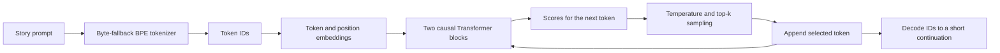

# NextWordPredictor

### A small Transformer that learns to continue children's stories, one token at a time.

NextWordPredictor is a hands-on language-model project built in stages, from early word prediction experiments to a compact decoder-only Transformer. The current V4 model was initialized with random weights and trained locally with PyTorch on synthetic children's-story text. It generates short continuations; it is not a general-purpose chatbot.

[](https://www.python.org/)
[](https://pytorch.org/)
[](https://arxiv.org/abs/1706.03762)
[](https://en.wikipedia.org/wiki/Natural_language_processing)
[](https://streamlit.io/)

## Try the Live Demo

**Deployment status: no public URL has been verified for this project yet.** The V4 app is ready in `streamlit_v4_app.py`, but I could not confirm an existing public Streamlit Community Cloud deployment.

To publish it, follow [the deployment steps below](#deploy-to-streamlit-community-cloud). After Streamlit provides a public URL and the app has been tested, replace this status with a **Launch Live Demo** link to that verified URL.

## Project Overview

A language model learns patterns in text and uses them to predict what token might come next. Given a prompt such as “Deep inside the forest, there lived”, V4 repeatedly predicts and samples another token to create a short continuation.

V4 focuses on children's-story style because that is the domain of its training data. It was trained on 30,000 stories from TinyStoriesV2_cleaned. Generation runs locally from the saved checkpoint and tokenizer; the web app does not download data, call an AI API, or retrain the model.

## How It Works



The tokenizer converts text into IDs from a fixed 2,048-token vocabulary. The Transformer uses the prompt tokens to produce scores for possible next tokens. The inference code samples one token, appends it to the context, and repeats until it reaches the short word limit or a stopping token.

## Model Architecture

| Setting | V4 value |
|---|---:|
| Parameters | **237,312** |
| Tokenizer | 2,048-symbol byte-fallback BPE |
| Embedding dimension | 64 |
| Causal Transformer blocks | 2 |
| Attention heads per block | 4 |
| Context length | 64 tokens |
| Dropout | 0.1 |
| Input/output token embeddings | Tied |
| Initialization and device | Random initialization; CPU training with PyTorch |
| Optimizer | AdamW, learning rate 0.0005 |

Each Transformer block combines masked self-attention with a feed-forward network. Causal masking prevents the model from using future tokens when predicting the next one. The input embedding weights are also used to score output tokens, which is called weight tying.

## Dataset

V4 uses a deterministic subset of [`fhswf/TinyStoriesV2_cleaned`](https://huggingface.co/datasets/fhswf/TinyStoriesV2_cleaned). The publisher describes the children's stories as GPT-4-generated synthetic text. “Synthetic” describes the source stories; V4 itself was trained from random model weights and does not use GPT-4 to generate its continuations.

| Split | Stories | Actual BPE tokens, including EOS |
|---|---:|---:|
| Train | 25,000 | 9,051,969 |
| Validation | 2,500 | 915,071 |
| Test | 2,500 | 907,851 |
| **Total** | **30,000** | **10,874,891** |

Stories stay intact as separate documents. The train-only tokenizer is fitted on training stories; validation is used to select the best checkpoint; the test split is held out for final loss measurement. Every story has an end-of-sequence marker, and training windows are built within individual stories.

The raw story files and prepared story text are not included in this repository. The committed manifest records source attribution, checksums, and subset counts.

## Training and Results

Training used random initialization, a fixed seed of 2024, four CPU threads, batch size 32, and AdamW at learning rate 0.0005. The run completed four epochs and 19,452 optimizer steps. The final epoch continued from the best checkpoint of the earlier V4 run with a newly initialized optimizer; the weights still trace back to random initialization.

| Epoch | Training loss | Validation loss |
|---:|---:|---:|
| 1 | 2.6905 | 2.1181 |
| 2 | 2.1395 | 1.9428 |
| 3 | 2.0370 | 1.8714 |
| 4 | 1.9901 | **1.8338** |

**Held-out test loss: 1.8420.** Combined CPU training time across the initial run and continuation was 53 minutes 23 seconds. A short benchmark measured about 0.133 seconds per training step for the selected configuration on the local machine. These losses measure next-token prediction on this dataset; they do not guarantee relevant or grammatically correct stories.

The results are recorded in [`artifacts/v4/v4_results_20261121_170608_22072_1b90f1c4.json`](artifacts/v4/v4_results_20261121_170608_22072_1b90f1c4.json) and [`artifacts/v4/v4_tinystories_benchmark_20261121.json`](artifacts/v4/v4_tinystories_benchmark_20261121.json).

## Example Generations

These are verbatim examples from the saved checkpoint's 15-prompt evaluation. The continuation is shown after each prompt.

| Prompt | Continuation |
|---|---|
| Once upon a time, there was a little girl who | loved to play outside. She liked to read her |
| Deep inside the forest, there lived | a little boy named Tim. Tim loved to share |
| The princess opened the mysterious box and | saw a big tree. The busy was very sad. |
| A little bird fell from its nest | and said, "Mia! I am not bored, but it |

The evaluation produced no empty continuations, repeated trigrams, or repeated-punctuation cases. One sample had unbalanced quotation marks. Those automated checks are limited surface checks, not a measure of story quality. The full prompt set and outputs are in [`artifacts/v4/v4_tinystories_eval_20261121.json`](artifacts/v4/v4_tinystories_eval_20261121.json).

## Evolution: V1 to V4

| Version | What changed | What it taught us / remaining issue |
|---|---|---|
| V1 | Began with WikiText-2 and word-level next-token prediction; the legacy track includes a Transformer and a second training stage. | A general text corpus and word vocabulary were a useful baseline, but outputs were weak and rare words were difficult to represent. |
| V2 | Moved to sentence-level text and a BPE tokenizer, using the High Quality English Sentences dataset. | Subword tokens cover word pieces more flexibly, but isolated sentences provide little story continuity. Validation loss was 4.7891 on its own setup. |
| V3 | Trained on filtered multi-sentence paragraphs from a pinned FineWeb-Edu sample shard; this is the model loaded by the existing `app.py`. | Paragraphs provide more context, but the web-text domain is not especially suited to children's-story prompts. Validation loss was 4.8330 on a different setup. |
| V4 | Changed the domain to synthetic children's stories and kept each story as a separate training document. Reduced the model and context to fit a CPU run. | The outputs are more story-like on some familiar prompts, but grammar, relevance, and continuity remain unreliable. |

V2 and V3 losses should not be compared directly with each other or V4: their data, tokenizers, and evaluation procedures differ. The V2 and V3 figures are context, not evidence that one is better solely because its loss is lower.

## Limitations

- This is a small, domain-focused next-token model, not a chatbot, general assistant, or story planner.
- It generates only a short continuation and can stop mid-sentence.
- It sometimes makes agreement errors, changes topic, or produces odd details.
- The 64-token context limits how much earlier text it can use.
- Synthetic children's stories are a narrow training domain; performance on other writing styles is not established.
- The 15 fixed prompts and simple repetition/quotation checks are a small evaluation, not a broad human study.

## Tech Stack

- **Python** for the training, data, and inference pipeline.
- **PyTorch** for the Transformer, loss, optimization, and checkpoint loading.
- **Custom byte-fallback BPE tokenizer** for reversible text-to-ID conversion.
- **Streamlit** for separate V3 and V4 browser interfaces.
- **PyArrow** for the FineWeb-Edu Parquet data-preparation pipeline.

## Run Locally

The V4 demo loads the included checkpoint and matching tokenizer. It does not need the training dataset.

```powershell
git clone https://github.com/sanjanarose-pixel/NextWordPredictor.git
cd NextWordPredictor
python -m venv .venv
.venv\Scripts\Activate.ps1
python -m pip install -r requirements.txt
```

Run V4 from the command line:

```powershell
python demo_v4.py --prompt "Once upon a time, there was a little rabbit who"
```

Run the separate V4 browser interface:

```powershell
python -m streamlit run streamlit_v4_app.py
```

To run the existing V3 interface instead, use `python -m streamlit run app.py`. The model and artifacts for each version remain separate.

## Project Structure

```text
.
├── app.py                         # Existing V3 Streamlit app
├── streamlit_v4_app.py             # V4 Streamlit app
├── demo_v4.py                      # V4 command-line demo
├── v4_model.py                     # V4 Transformer architecture
├── v4_tokenizer.py                 # V4 byte-fallback BPE tokenizer
├── v4_data.py                      # Document checks and window helpers
├── v4_inference.py                 # Checkpoint loading and generation
├── train_v4_model.py               # V4 CPU training and validation
├── prepare_v4_tinystories.py       # Deterministic story subset and splits
├── download_v4_tinystories.py      # Downloads selected source shards
├── evaluate_v4.py                  # Fixed-prompt evaluation
├── benchmark_v4.py                 # CPU step benchmark
├── artifacts/v4/                   # V4 checkpoint, tokenizer, and reports
├── data/v4/tinystories_manifest.json # Attribution and data selection manifest
├── tests/                          # Offline unit tests
└── train_v3_model.py, high_quality_*.py, language_model*.py
                                   # Earlier version training code
```

Run the test suite with:

```powershell
python -m unittest discover -s tests -v
```

## Dataset Attribution and License

Attribution: *TinyStoriesV2_cleaned*, published by Fachhochschule Südwestfalen (fhswf); the dataset publisher describes the stories as GPT-4-generated and acknowledges the original TinyStories authors. Source: [dataset card](https://huggingface.co/datasets/fhswf/TinyStoriesV2_cleaned). License: [CDLA-Sharing-1.0](https://cdla.dev/sharing-1-0/).

This repository includes the attribution and subset manifest but does not redistribute the raw stories or prepared story text. If source or modified dataset material is redistributed, CDLA-Sharing-1.0 requires preserving attribution and source links, clearly marking modifications, and sharing the data under the unmodified license without adding restrictions that remove its sharing rights. Review the [license text](https://cdla.dev/sharing-1-0/) before redistributing dataset material. The model checkpoint is included as a trained artifact; this README does not make a legal determination about every possible downstream use.

## Future Improvements

- Evaluate more prompts with structured human review for grammar, relevance, and continuity.
- Increase the story corpus and model capacity if compute resources allow.
- Improve generation stopping and quotation handling.
- Add a verified public demo URL after deployment.
- Compare future checkpoints on the same held-out split and fixed prompts.

## Deploy to Streamlit Community Cloud

The repository is prepared for a separate V4 app, but deployment requires signing in to Streamlit Community Cloud with an account that can access the GitHub repository.

1. Open [Streamlit Community Cloud](https://share.streamlit.io/) and choose **Create app**.
2. Select the option to deploy an existing app.
3. Set **Repository** to `sanjanarose-pixel/NextWordPredictor`, **Branch** to `main`, and **Main file path** to `streamlit_v4_app.py`.
4. In **Advanced settings**, choose Python 3.12, then deploy.
5. Wait for startup and test a sample prompt. Copy the public `streamlit.app` URL and replace the pending status near the top of this README with that verified link.

See Streamlit's [official deployment guide](https://docs.streamlit.io/deploy/streamlit-community-cloud/deploy-your-app/deploy) for the current setup flow. The V4 app loads the saved checkpoint and tokenizer; it does not train during deployment.
