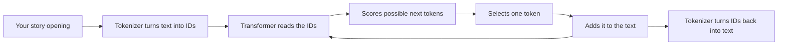

# NextWordPredictor

### A small Transformer that continues children's stories one piece of text at a time.

NextWordPredictor is a learning project about how language models generate text. Its latest version, V4, was trained from randomly initialized weights on synthetic children's stories. Give it a short story opening and it will try to write a short continuation. It is a small, focused model, not a general-purpose chatbot.

[](https://www.python.org/)
[](https://pytorch.org/)
[](https://arxiv.org/abs/1706.03762)
[](https://en.wikipedia.org/wiki/Natural_language_processing)
[](https://streamlit.io/)

## Try the Live Demo

[**Open NextWordPredictor V4 in your browser**](https://nextwordpredictor-zwfvbpw73rtjzv.streamlit.app/)

Enter a short story opening and select **Continue story**. You do not need to install Python or download the project to try the hosted demo.

## Project Overview

A language model learns patterns from examples of text. When you give it a prompt, it predicts what piece of text is likely to come next, adds that piece to the prompt, and repeats the process.

That piece is called a **token**. A token may be a whole word, part of a word, punctuation, or whitespace. For example, after `Deep inside the forest, there lived`, V4 may generate a continuation such as `a little boy named Tim...`.

V4 is trained for children's-story-style text because that is what it saw during training. It runs from a saved model checkpoint and matching tokenizer. The app does not train the model when a visitor opens it, send prompts to an AI service, or download the training stories.

## How It Works



The tokenizer is the part that converts text into numbers the model can process. V4 uses **byte-fallback BPE**: it combines common pieces of text into useful tokens and can still represent unusual characters using their underlying bytes. Its vocabulary has 2,048 token IDs.

The Transformer uses the prompt to score possible next tokens. It is trained with a **causal mask**, which means it can use earlier tokens but is prevented from looking at future ones. During generation, the app chooses a token, adds it to the running text, and repeats until it reaches the short output limit or a stop token.

## Model Architecture

| Setting | V4 configuration |
|---|---:|
| Learned model parameters | **237,312** |
| Tokenizer vocabulary | 2,048 byte-fallback BPE tokens |
| Embedding size | 64 numbers per token |
| Transformer blocks | 2 |
| Attention heads per block | 4 |
| Context window | 64 tokens |
| Dropout | 0.1 |
| Token input/output weights | Tied (shared) |
| Starting weights and device | Random initialization; trained on CPU with PyTorch |
| Optimizer | AdamW, learning rate 0.0005 |

An **embedding** is a list of learned numbers used to represent a token. A Transformer block uses attention to combine information from earlier tokens, then a small feed-forward network to process that information. V4 has two such blocks and four attention heads in each. The input and output token embeddings are tied, meaning the same learned token weights are reused when the model scores possible output tokens.

The model has 237,312 learned parameters. A parameter is a number the training process adjusts so the model gets better at predicting the next token. The model starts with random weights; no pretrained model weights are used.

## Dataset

V4 uses a deterministic subset of [`fhswf/TinyStoriesV2_cleaned`](https://huggingface.co/datasets/fhswf/TinyStoriesV2_cleaned). The publisher describes these as synthetic children's stories generated with GPT-4. This describes how the training stories were made; V4 itself does not call GPT-4 to generate text.

| Split | Stories | Actual tokenizer tokens, including each story's EOS marker |
|---|---:|---:|
| Training | 25,000 | 9,051,969 |
| Validation | 2,500 | 915,071 |
| Test | 2,500 | 907,851 |
| **Total** | **30,000** | **10,874,891** |

The **training split** is used to teach the model and fit the tokenizer. The **validation split** is used during training to choose the best checkpoint. The **test split** is kept aside until the end for a final measurement.

Each story remains its own document. Its end marker, called **EOS** (end of sequence), tells the model where that story stops. Training windows are made within each story so the end of one story is not accidentally joined to the start of another. The tokenizer is fitted only on the training stories.

The repository includes the attribution and a manifest with source checksums and selection counts, but not the raw story files or prepared story text.

## Training and Results

V4 was trained locally on CPU with PyTorch. Training began with random weights, used seed 2024, four CPU threads, batches of 32 windows, and the AdamW optimizer at learning rate 0.0005. One **epoch** means one pass through the training windows. The run completed four epochs and 19,452 optimizer steps. The final epoch continued from the best checkpoint of the preceding run with a newly initialized optimizer; the model weights still trace back to random initialization.

| Epoch | Training loss | Validation loss |
|---:|---:|---:|
| 1 | 2.6905 | 2.1181 |
| 2 | 2.1395 | 1.9428 |
| 3 | 2.0370 | 1.8714 |
| 4 | 1.9901 | **1.8338** |

**Held-out test loss: 1.8420.** Loss measures how surprised the model was by the next tokens in a split; lower loss means better next-token predictions on that text. It does not by itself measure whether a story is interesting, relevant, or grammatically correct.

Combined CPU training time for the initial run and continuation was 53 minutes 23 seconds. A short benchmark measured about 0.133 seconds per training step for the selected configuration on the local machine. The saved results are in [`artifacts/v4/v4_results_20261121_170608_22072_1b90f1c4.json`](artifacts/v4/v4_results_20261121_170608_22072_1b90f1c4.json) and [`artifacts/v4/v4_tinystories_benchmark_20261121.json`](artifacts/v4/v4_tinystories_benchmark_20261121.json).

## Example Generations

These are actual outputs from the saved checkpoint's 15-prompt evaluation. They show both plausible starts and mistakes. Text after the vertical bar is what the model added.

| Prompt | Model continuation |
|---|---|
| Once upon a time, there was a little girl who | loved to play outside. She liked to read her |
| Deep inside the forest, there lived | a little boy named Tim. Tim loved to share |
| The princess opened the mysterious box and | saw a big tree. The busy was very sad. |
| A little bird fell from its nest | and said, "Mia! I am not bored, but it |

In the fixed evaluation, all 15 prompts received a continuation. The automatic checks found no repeated trigrams or repeated-punctuation cases, but one sample had unbalanced quotation marks. These are simple surface checks, not a quality score. The full prompts, outputs, and checks are in [`artifacts/v4/v4_tinystories_eval_20261121.json`](artifacts/v4/v4_tinystories_eval_20261121.json).

## Evolution: V1 to V4

The project grew through several approaches to the same basic task: predict what text comes next. Each version changed the data, the way text was represented, or the amount of context.

| Version | What it used | What changed and what remained difficult |
|---|---|---|
| V1 | WikiText-2 and word-level prediction; the legacy track includes a Transformer and a second training stage. | This was the initial text-prediction baseline. Rare and unknown words were difficult to handle, and generated text was weak. |
| V2 | Sentence-level text from the High Quality English Sentences dataset, represented with BPE subword tokens. | Subword tokens can represent parts of unfamiliar words, but training on separate sentences gives little story context. Its validation loss was 4.7891 on its own setup. |
| V3 | Filtered multi-sentence paragraphs from a pinned FineWeb-Edu sample shard. The existing `app.py` loads this model. | Paragraphs give the model more context, but general web text is not a good match for children's-story prompts. Its validation loss was 4.8330 on a different setup. |
| V4 | 30,000 synthetic children's stories, kept as independent documents. A smaller Transformer and shorter context made CPU training practical. | Some familiar story openings get plausible continuations, but grammar, relevance, and continuity are still unreliable. |

V2, V3, and V4 used different data, tokenizers, and evaluation procedures. Their losses should not be compared as if they were measured under identical conditions.

## Limitations

- V4 predicts the next token; it is not a chatbot, general assistant, or story planner.
- It is designed for short continuations and may stop in the middle of a sentence.
- It can make grammar mistakes, change topic, or produce odd details.
- Its 64-token context limits how much earlier text it can use.
- Its training data is a narrow collection of synthetic children's stories. Its performance on other kinds of writing has not been established.
- The evaluation used 15 fixed prompts and basic automatic checks, not a large human study.

## Tech Stack

- **Python** runs the project code.
- **PyTorch** implements the neural network, training, and checkpoint loading.
- **Custom byte-fallback BPE tokenizer** converts text to token IDs and back.
- **Streamlit** provides separate browser apps for V3 and V4.
- **PyArrow** reads Parquet files in the FineWeb-Edu data-preparation pipeline.

## Run Locally

The V4 checkpoint and matching tokenizer are included. You do not need the training dataset just to run the demo.

```powershell
git clone https://github.com/sanjanarose-pixel/NextWordPredictor.git
cd NextWordPredictor
python -m venv .venv
.venv\Scripts\Activate.ps1
python -m pip install -r requirements.txt
```

Generate a V4 continuation from the command line:

```powershell
python demo_v4.py --prompt "Once upon a time, there was a little rabbit who"
```

Launch the V4 browser app locally:

```powershell
python -m streamlit run streamlit_v4_app.py
```

To launch the separate V3 app, run `python -m streamlit run app.py`. V3 and V4 use separate code paths and model artifacts.

Run the offline unit tests with:

```powershell
python -m unittest discover -s tests -v
```

## Project Structure

```text
.
├── app.py                            # Existing V3 browser app
├── streamlit_v4_app.py                # V4 browser app
├── demo_v4.py                         # V4 command-line demo
├── v4_model.py                        # V4 Transformer
├── v4_tokenizer.py                    # V4 text/token converter
├── v4_data.py                         # Document checks and training windows
├── v4_inference.py                    # Loads V4 files and generates text
├── train_v4_model.py                  # V4 training and validation
├── prepare_v4_tinystories.py          # Story cleanup and data splits
├── download_v4_tinystories.py         # Downloads selected source files
├── evaluate_v4.py                     # Fixed-prompt evaluation
├── benchmark_v4.py                    # CPU speed benchmark
├── artifacts/v4/                      # V4 checkpoint, tokenizer, and reports
├── data/v4/tinystories_manifest.json  # Dataset source and selection details
├── tests/                             # Offline unit tests
└── language_model*.py, high_quality_*.py, generation_*.py
                                       # Earlier project versions
```

## Dataset Attribution and License

Attribution: *TinyStoriesV2_cleaned*, published by Fachhochschule Südwestfalen (fhswf). The publisher describes the stories as GPT-4-generated and acknowledges the original TinyStories authors. See the [dataset card](https://huggingface.co/datasets/fhswf/TinyStoriesV2_cleaned). The dataset is marked **CDLA-Sharing-1.0**; read the [license](https://cdla.dev/sharing-1-0/).

This repository includes the attribution and selection manifest, but does not redistribute the raw stories or prepared story text. If you redistribute source or modified dataset material, the license requires preserving attribution and source links, clearly marking modifications, and sharing the data under the unmodified license without adding restrictions that remove its sharing rights. Review the license before redistributing dataset material. The trained model checkpoint is included as a project artifact; this README does not make a legal determination about every possible downstream use.

## Future Improvements

- Review more generated examples for grammar, relevance, and story continuity.
- Use more stories or a larger model if more compute resources become available.
- Improve how generation handles sentence endings and quotation marks.
- Compare future models using the same test data and prompt set.

## Public Deployment

The V4 browser app is deployed with Streamlit Community Cloud from this repository's `main` branch, using `streamlit_v4_app.py` as its entrypoint. [Open the public demo](https://nextwordpredictor-zwfvbpw73rtjzv.streamlit.app/).
